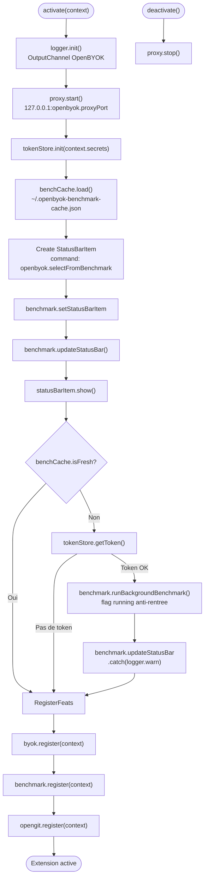
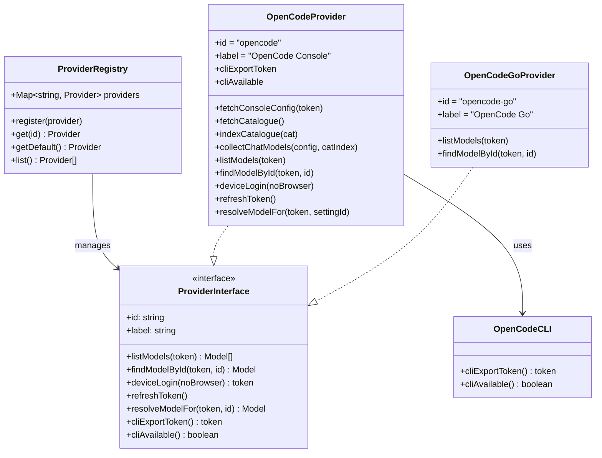
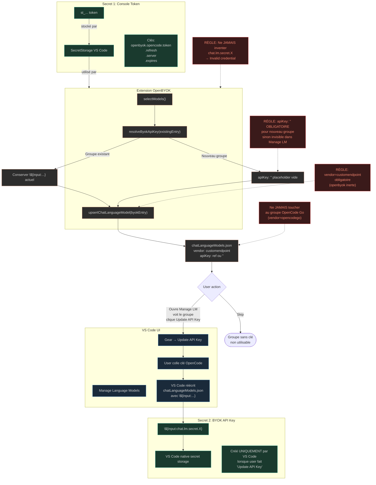
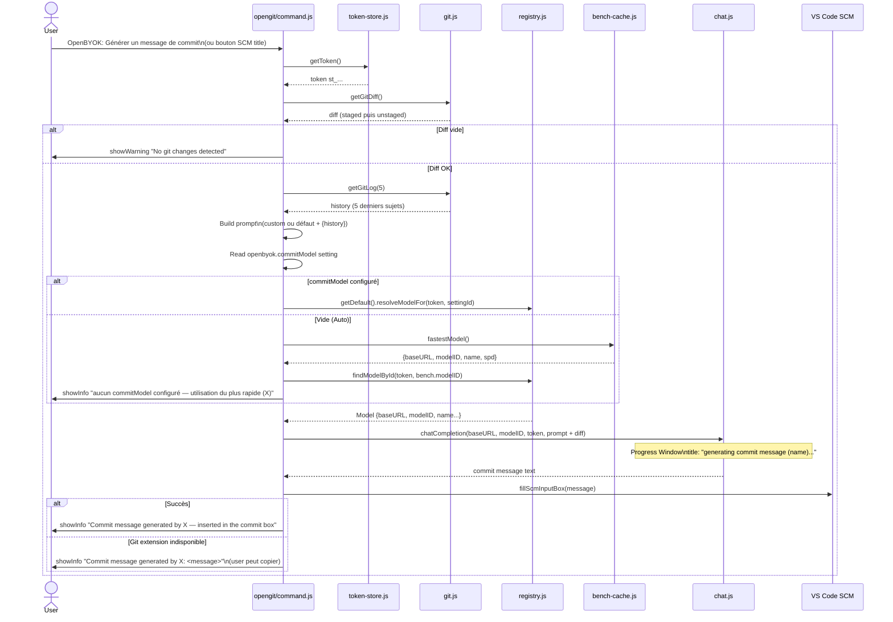
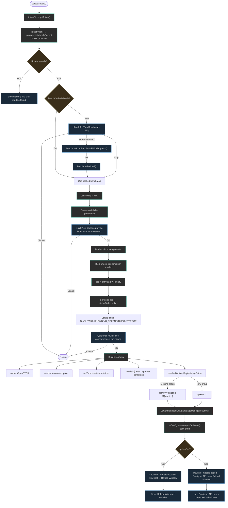
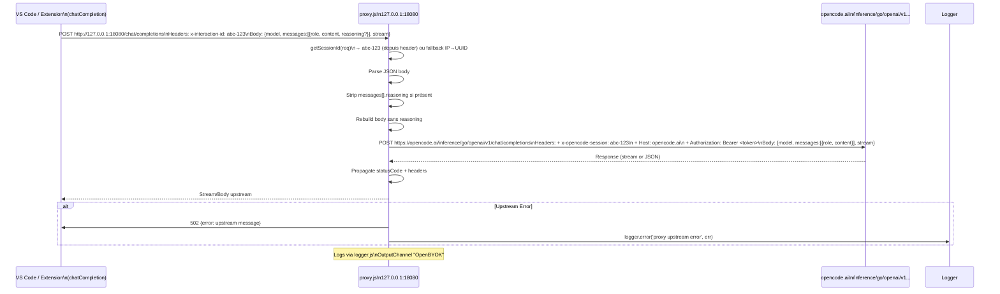
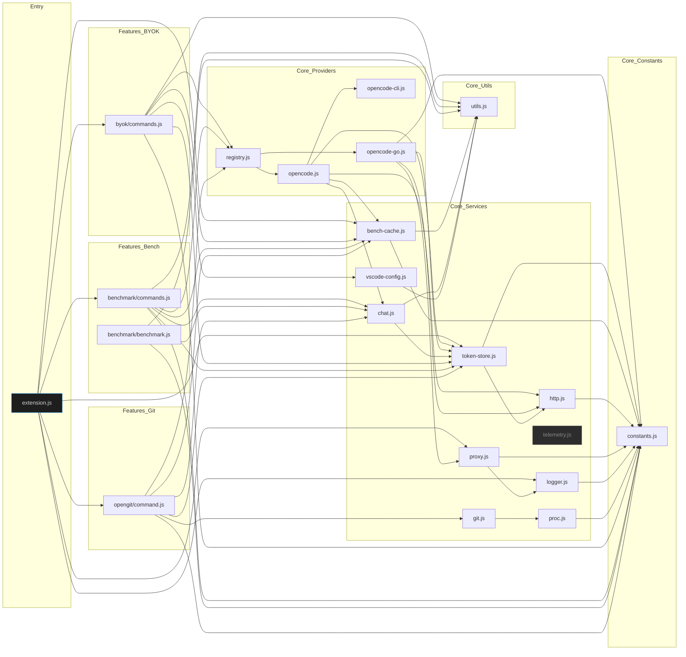

# OpenBYOK — Mermaid Diagrams

> Diagrammes Mermaid générés depuis l'analyse du code source `src/` (2026-11-15).
> À visualiser dans VS Code (extensión **Markdown Preview Mermaid Support**) ou tout viewer Mermaid.

---

## 1. Architecture Globale

```mermaid
graph TB
    subgraph VSCode[VS Code Extension Host]
        direction TB
        Ext[extension.js\nactivate/deactivate]
        
        subgraph Core[core/]
            Const[constants.js]
            Utils[utils.js]
            
            subgraph Providers[providers/]
                Registry[registry.js\nMap<id, Provider>]
                OCode[opencode.js\nOpenCode Console]
                OCLI[opencode-cli.js\nCLI local]
                OGo[opencode-go.js\nOpenCode Go]
            end
            
            subgraph Services[services/]
                Token[token-store.js\nSecretStorage + authFetch]
                Bench[bench-cache.js\nJSON file + TTL 2h]
                HTTP[http.js\ngetJson/postJson + retry]
                Proc[proc.js\nexecFileAsync]
                Git[git.js\ndiff + SCM input]
                Chat[chat.js\ncompletion + stream SSE]
                VSC[vscode-config.js\nchatLanguageModels.json]
                Proxy[proxy.js\n127.0.0.1:18080]
                Log[logger.js\nOutputChannel OpenBYOK]
                Tele[telemetry.js\nmodule orphelin]
            end
        end
        
        subgraph Features[features/]
            BYOK[byok/commands.js\n6 commandes]
            BenchCmd[benchmark/commands.js\n3 cmd + status bar]
            OGit[opengit/command.js\n2 commandes commit]
        end
    end
    
    %% Wiring
    Ext --> Log
    Ext --> Proxy
    Ext --> Token
    Ext --> Bench
    Ext --> BYOK
    Ext --> BenchCmd
    Ext --> OGit
    
    %% Core internal
    Registry --> OCode
    Registry --> OGo
    OCode --> Token
    OCode --> Bench
    OCode --> HTTP
    OCode --> Chat
    OCode --> OCLI
    OGo --> Token
    OGo --> HTTP
    OGo --> Proxy
    BYOK --> Registry
    BYOK --> Bench
    BYOK --> VSC
    BYOK --> Token
    BenchCmd --> Registry
    BenchCmd --> Token
    BenchCmd --> Bench
    BenchCmd --> Chat
    OGit --> Registry
    OGit --> Token
    OGit --> Git
    OGit --> Chat
    OGit --> Bench
    
    %% External
    Token -->|SecretStorage| VSCodeSecrets[(VS Code\nSecretStorage)]
    VSC -->|chatLanguageModels.json| CLM[(%APPDATA%/Code/User\nchatLanguageModels.json)]
    VSC -->|settings.json inputs| Settings[(%APPDATA%/Code/User\nsettings.json)]
    Bench -->|~/.openbyok-benchmark-cache.json| BenchFile[(~/.openbyok-benchmark-cache.json)]
    Proxy -->|HTTPS| OAI[(opencode.ai)]
    OCode -->|HTTPS| OAI
    OGo -->|HTTPS| OAI
    Git -->|git CLI| Repo[(Workspace Git)]
    
    classDef ext fill:#1e1e1e,color:#d4d4d4,stroke:#007acc;
    classDef core fill:#2d2d2d,color:#d4d4d4,stroke:#4ec9b0;
    classDef feat fill:#2d2d2d,color:#d4d4d4,stroke:#ce9178;
    classDef extSys fill:#0e1a2b,color:#9cdcfe,stroke:#569cd6;
    
    class Ext ext;
    class Const,Utils,Registry,OCode,OCLI,OGo,Token,Bench,HTTP,Proc,Git,Chat,VSC,Proxy,Log,Tele core;
    class BYOK,BenchCmd,OGit feat;
    class VSCodeSecrets,CLM,Settings,BenchFile,OAI,Repo extSys;
```



---

## 2. Flux d'Activation (`extension.js`)



---

## 3. Registre des Providers — Interface Commune



---

## 4. Flux d'Authentification Device Flow (OpenCode Console)

```mermaid
sequenceDiagram
    actor User
    participant BYOK as byok/commands.js
    participant Provider as opencode.js
    participant TokenStore as token-store.js
    participant OAI as opencode.ai
    participant Browser as Navigateur
    
    User->>BYOK: OpenBYOK: Register API Token
    BYOK->>User: QuickPick: Device flow / CLI
    User->>BYOK: Choisi "Device flow (browser login)"
    BYOK->>User: QuickPick: Auto browser / Manual URL
    User->>BYOK: Choisi mode
    
    alt Browser auto
        Provider->>OAI: POST /auth/device/code {client_id:opencode}
        OAI-->>Provider: {device_code, user_code, verification_uri_complete, expires_in, interval}
        Provider->>Browser: openExternal(verification_uri_complete)
        Provider->>User: showInfo "Confirm code XXXX"
    else Manual
        Provider->>OAI: POST /auth/device/code
        OAI-->>Provider: {device_code, user_code, verification_uri_complete...}
        Provider->>User: showInfo + copy URL to clipboard
    end
    
    loop Polling (jusqu'à deadline)
        Provider->>Provider: sleep(interval)
        Provider->>OAI: POST /auth/device/token {grant_type:device_code, device_code, client_id}
        OAI-->>Provider: {access_token?, refresh_token?, expires_in?} ou {error}
        
        alt access_token reçu
            Provider->>TokenStore: storeToken(access, {server, refreshToken, expiresInMs})
            TokenStore-->>Provider: OK
            Provider->>User: showInfo "Token registered successfully"
            break
        else pas de token
            Note right of Provider: Traiter réponse erreur...
        end
        
        opt authorization_pending
            Note right of Provider: Continuer le polling
        end
        
        opt slow_down
            Provider->>Provider: interval += 5000ms
        end
        
        opt error
            Provider->>User: showError "Auth failed: error"
            break
        end
    end
    
    alt Timeout (deadline dépassé)
        Provider->>User: showError "Authorization timed out"
    end
```

---

## 5. Système de Benchmark & Cache

```mermaid
flowchart TD
    subgraph Benchmark[benchmark/]
        direction TB
        
        Model["Model\n{key, modelID, baseURL...}"]
        Token["Token st_..."]
        Config["benchConfig()\ntimeout/concurrence"]
        
        BenchModel["benchmarkModel(model, token, timeout)"]
        ToCache["toCacheEntry(model, bench)"]
        
        RunPool["runPool(models, worker, concurrency)"]
        
        BG["runBackgroundBenchmark()\nflag running"]
        Progress["runBenchmarkWithProgress()\nwithProgress + cancellable"]
        Clear["clearCache()"]
        Select["selectFromBenchmark()\nstatusBar click"]
        
        Fastest["benchCache.fastestModel()\nspd asc, ttftMs asc"]
    end
    
    subgraph Cache[bench-cache.js]
        Load["load()"]
        Save["save(results)\natomic .tmp+rename"]
        Fresh["isFresh()\nTTL 2h"]
        Age["ageLabel()"]
        Get["getEntry(key)"]
        Data["data()"]
        Clr["clear()\nunlinkSync"]
    end
    
    %% BenchmarkModel internals
    BenchModel --> ChatStream["chatCompletionStream\nSSE + onToken delta"]
    ChatStream --> Measure["Measure:\n- ttftMs (premier delta)\n- totalMs\n- tokens count\n- tokensPerSec"]
    Measure --> Status{Status}
    Status -- OK --> OK["✅ OK\nttft≤5s ∧ tok/s≥5"]
    Status -- Slow --> Slow["🐌 SLOW\nttft>5s ∨ tok/s<5"]
    Status -- Timeout --> TO["⏱️ TIMEOUT"]
    Status -- Error --> Err["❌ ERROR"]
    Status -- NoTokens --> NT["⚠️ NO_TOKENS"]
    
    OK --> CalcSPD["spd = totalMs/tokens*1000\nsec/1k tokens"]
    Slow --> CalcSPD
    TO --> CalcSPD
    Err --> CalcSPD
    NT --> CalcSPD
    
    CalcSPD --> BenchResult["BenchResult\n{status, ttftMs, tokensPerSec, spd, error}"]
    BenchResult --> ToCache
    ToCache --> CacheEntry["CacheEntry\n{key, modelID, name, providerID, baseURL,\nstatus, ttftMs, tokensPerSec, spd, error,\ncontextWindow, maxInputTokens...}"]
    
    %% Flux principaux
    BG --> Token
    BG --> Registry["registry.list()"]
    Registry --> ListModels["provider.listModels(token)"]
    ListModels --> Filter["Filter: exclure opencode-go non -free"]
    Filter --> RunPool
    RunPool --> BenchModel
    BenchModel --> ToCache
    ToCache --> Save
    Save --> UpdateSB["updateStatusBar()"]
    
    Progress --> ProviderPick["QuickPick: All providers / provider.id"]
    ProviderPick --> ListModels
    
    Select --> CacheData{"Cache results?"}
    CacheData -- Non --> Progress
    CacheData -- Oui --> BuildItems["Build QuickPick items"]
    BuildItems --> AutoItem["⚡ Auto (fastest)\nmodelID=''"]
    BuildItems --> ModelItems["Models triés par spd asc"]
    AutoItem --> UserPick["User QuickPick"]
    ModelItems --> UserPick
    UserPick --> SetConfig["openbyok.commitModel = pick.modelID"]
    
    subgraph StatusBar[Status Bar Item]
        UpdateSB --> SBText{"Cache frais?"}
        SBText -- Oui --> SBOK["$(dashboard) OpenBYOK: name spds/1k (Xm)"]
        SBText -- Non --> SBEmpty["$(dashboard) OpenBYOK: no cache"]
        SBOK --> Tooltip["Tooltip: N models, X min ago"]
        SBEmpty --> Tooltip2["Tooltip: Click to run benchmark"]
    end
    
    style BenchModel fill:#3a3a2e,stroke:#dcdcaa
    style CacheEntry fill:#2e3a3a,stroke:#4ec9b0
    style RunPool fill:#3a2e3a,stroke:#ce9178
```



---

## 6. Modèle de Credentials BYOK — Règle Critique



---

## 7. Génération de Message de Commit (OpenGIT)



---

## 8. Flux selectModels (BYOK) — Deux Étapes



---

## 9. Proxy OpenCode Go — Request Flow



---

## 10. Dépendances & Couplage (Vue Fichier)



---

## Comment utiliser

1. **VS Code** : installez *Markdown Preview Mermaid Support* → ouvrez `MERMAID.md` → `Ctrl+Shift+V` (Preview).
2. **GitHub/GitLab** : les diagrammes s'affichent nativement dans les `.md`.
3. **Mermaid Live Editor** : copiez un bloc ````mermaid ... ```` dans <https://mermaid.live/>.
4. **Export** : VS Code → *Print to PDF* depuis la preview, ou outil CLI `mmdc` (`npm i -g @mermaid-js/mermaid-cli`).

---

*Généré le 2026-11-15 — source unique : `src/`*